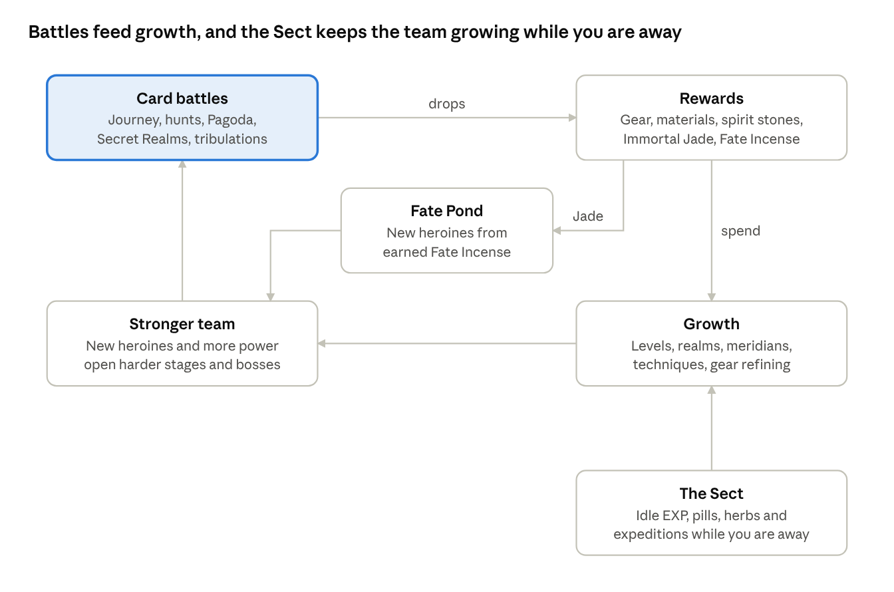
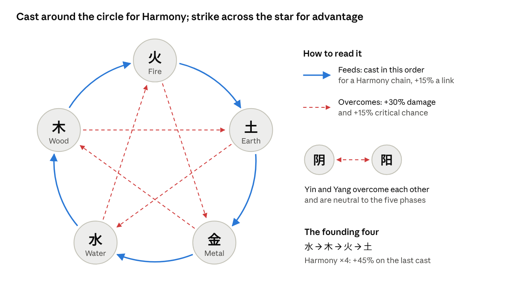
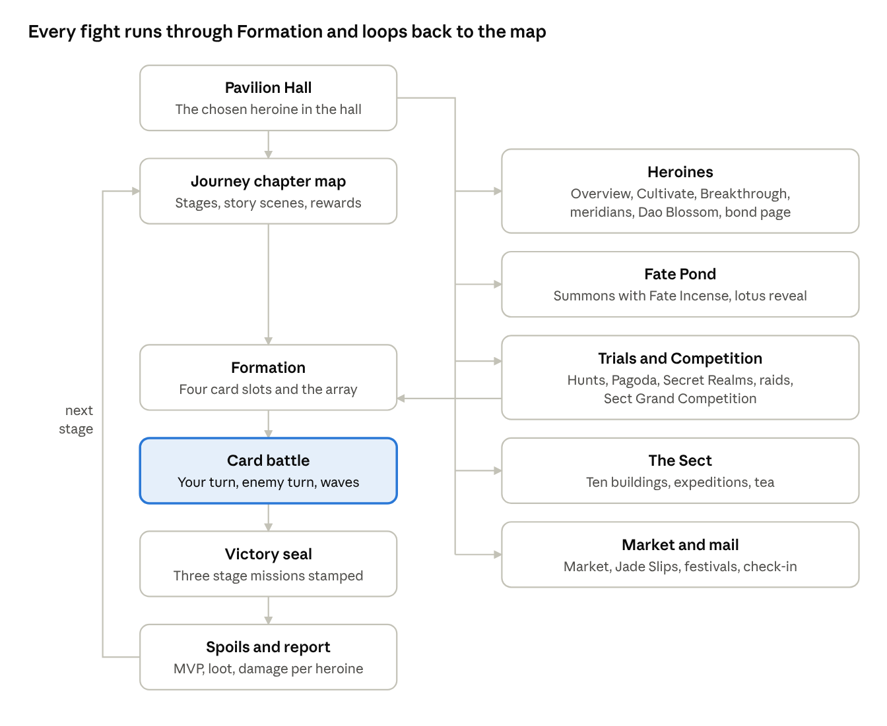

# Immortal Blossoms Game Specification

November 1, 2026 · Elie

Immortal Blossoms is a premium, fully offline, landscape card-battle RPG for Android. You rebuild a fallen sect by gathering female cultivators, raising them through the cultivation realms and fighting fast card battles inspired by SPAM, with Epic Seven's hero-building depth, no shop, no stamina wall and no PvP.

## At a glance

The game keeps Epic Seven's hero-building depth, fights its battles with cards in the style of SPAM, replaces every system built to sell or to connect online, and adds a cultivation layer taken from xianxia novels.

### Design pillars

1. **Collect the Hundred Blossoms.** Every heroine is a reborn flower immortal with her own story, Dao flower and bonds. Any heroine can be raised to the top, whatever her rarity. Cards keep a large roster affordable: a heroine needs a few illustrations, not a set of animations.
2. **Battles won by thinking.** SPAM-style card battles: four cards a side and every ready technique each turn, in the order you choose. Casting along the Five Phases cycle builds Harmony chains, and Spirit Qi, Fortuitous Encounters and boss Qi shields add a choice every round.
3. **Cultivation you can see.** Heroines break through named realms, survive heavenly tribulations and open meridians. Each step changes her card's frame and how she fights.
4. **Respect for the player.** Pay once and play offline forever: no shop, no stamina wall, no heroine that is only available for a limited time, and sweep or auto-battle for anything already beaten.

### What we keep, change and drop from Epic Seven

| Epic Seven | Immortal Blossoms | Why |
| --- | --- | --- |
| Animated 2D battles, Combat Readiness turn order, S1/S2/S3 skills | Card battles in the style of SPAM: four cards a side, whole-team turns, three techniques on cooldown rings | Readable on a phone, faster rounds, and a heroine needs a few illustrations instead of a dozen animations |
| Soul Burst on a shared Soul gauge | Spirit Qi, earned every turn and spent to Empower a technique or on Fortuitous Encounters | One resource with two uses: a real choice every turn |
| Fire, Ice, Earth triangle plus Light and Dark | Five Phases cycle plus Yin and Yang, with Harmony chains for casting in feeding order | Native to xianxia, and casting order becomes the puzzle |
| Speed | Haste, which recharges techniques faster | Keeps the speed-gear chase in a game without a turn order |
| Promotion by feeding copies of heroes | Realm breakthroughs with pills and a tribulation trial | No fodder grind, and each breakthrough becomes a story moment |
| Awakening with runes | Opening six meridians | Same depth, cultivation flavour |
| Memory Imprint from duplicates | Dao Blossom: six petals that improve her kit, like Genshin Impact's constellations, opened by duplicates or Blossom Dew earned in play | Duplicates help but are never required |
| Gear with 6 slots, sets, substats, +15, reforging, Exclusive Equipment | Ten slots (weapon, helmet, body, gloves, boots, pants, two rings, pendant and Spirit Artefact), ten sets, eight rarities from Common to Divine with rolled stats, and unique gear at the top of the endgame | A proven farming loop with a long chase |
| Artifacts | Spirit Artefacts, named magic treasures earned from content, not summons | Summoning stays about heroines |
| Pets | Spirit beasts | Sweep helpers and lobby companions |
| Sanctuary | The Sect, a home base with idle cultivation and expeditions | Gives offline progress a place |
| Energy and Leifs | Dropped. Heavenly Fortune, a bonus that refills while you are away, replaces them | A stamina wall exists to sell refills |
| Covenant and Mystic summons, limited banners | One Fate Pond paid with earned currency, a rotating featured heroine, pity and a free pick | A fair gacha with no money involved |
| Arena, real-time arena, guilds, guild war | Sect Grand Competition against AI sects, raids, and records against your own best | The game is fully offline |
| Epic Pass with a paid track | Path of Ascension, every tier free | Same goals, no paywall |
| Limited side-story events | Festival events on the lunar calendar, replayable later from an archive | No fear of missing out |
| Hunts, Labyrinth, Abyss, Automaton Tower, Raid, Spirit Altar | Kept, reskinned and partly reworked | Proven farming and challenge content (see Game modes) |

Battles pay out gear and materials that buy growth, and a stronger team opens harder battles. Jade buys summons from the Fate Pond, and the Sect adds growth while you are away.

## World and story

You are the master of a ruined sect who can see threads of fate. You gather the reborn flower immortals before a Netherworld calamity devours them.

### Setting

- **The Garden of a Hundred Blossoms.** On Mount Kunlun, beside the Jade Pool, one celestial flower grew for each immortal maiden. The flower is her Dao Seed, the root of her power.
- **The Withering.** Three thousand years ago the Netherflame Sovereign led a Yin tide out of the Netherworld and burned the Garden. The flower immortals fell into the cycle of rebirth.
- **Today.** They are reborn across the Nine Provinces as gifted girls of rival sects, clans and demon races, unaware of their past. Their Dao Seeds wake as they cultivate, and the Netherflame Sect hunts them to harvest the seeds.
- **Inspiration.** The classic novel *Flowers in the Mirror* (Jinghua Yuan, completed in 1827), where a hundred flower spirits are punished by the gods and reborn on earth as talented women. It is public domain and gives the premise real cultural roots.

### The player

- You are the **Pavilion Master**, an unseen protagonist named by the player. Heroines speak to you directly, as the commander does in most hero collectors.
- You inherit the ruined Hundred Blossoms Pavilion and the **Fate Lotus**, a relic that senses karmic threads. Summoning is part of the story: you follow a thread and a reborn Blossom answers.
- Your goals: rebuild the Pavilion, gather the Blossoms, learn who you were in the Garden (you were its Gardener), and seal the Netherflame Sovereign.

### Factions

| Faction | Role in the game | Linked heroine |
| --- | --- | --- |
| Hundred Blossoms Pavilion | Your sect and home base | All of them, eventually |
| Frostpeak Sword Sect | Orthodox sword sect of the northern snows | Ling Shuang |
| Moonshadow Pavilion | Assassins for hire who live by a code | Mo Yingyue |
| Jade Lotus Temple | Healer nuns of the central plains | Su Lianhua |
| Vermilion Phoenix Palace | Fire arcanists of the southern volcanoes | Yan Feihong |
| Myriad Treasures Guild | Merchants: market, auction house, wandering merchant | Market keeper |
| Tianji Pavilion | Fate readers who sell secrets | Quest giver |
| Netherflame Sect | Yin cultivators who raise wraiths | Main antagonists |
| Demon clans (fox, serpent, crane) | Ally or enemy depending on the chapter | Several 5★ heroines |

### Story structure

The story is told in **Volumes** (Epic Seven's Episodes). A volume has 5 chapters; a chapter is a region map with 8 to 10 stages: story scenes, battles, a boss, side commissions and chance encounters.

Volume 1, *The Withered Garden*, ships at launch:

| Chapter | Region | What happens | Heroine who joins |
| --- | --- | --- | --- |
| 1 | Peach Blossom Ford | Wraiths burn a river village; Su Lianhua shields the refugees and the tutorial begins | Su Lianhua |
| 2 | Frostpeak | A Frostpeak elder sells the sect's disciples to the Netherflame Sect; Ling Shuang refuses to kneel | Ling Shuang |
| 3 | Moonshadow Bamboo Sea | Mo Yingyue is hired to kill you, then breaks her contract | Mo Yingyue |
| 4 | Vermilion Ruins | The Phoenix Palace's sealed fire is stolen; Yan Feihong hunts the thief | Yan Feihong |
| 5 | Gate of the Jade Pool | First clash with the Netherflame Matriarch; the Pavilion rises again | None (boss chapter) |

The four heroines of the card prototype join through the story, so every player gets a strong first team. Their phases form a full Harmony chain, Water → Wood → Fire → Earth (see Combat), which the tutorial uses to teach casting order.

Later volumes arrive as free updates: *The Drowned Dragon Palace* (Water), *Desert of Nine Suns* (Yang), *The Netherworld* (Yin) and *Return to Kunlun*.

Story scenes use portraits with expressions, act and location title cards, auto-play, a log and a skip button, as in your captures.

## Heroines

The launch roster has 30 heroines, one for each pairing of the five phases and six cultivation paths. Yin and Yang heroines arrive in free updates.

### Elements: the Five Phases plus Yin and Yang

| Element | Strong against | Weak against | Variants used in skills | Fighting style |
| --- | --- | --- | --- | --- |
| Metal 金 | Wood | Fire | Sword light, moonsteel | Precision, critical hits, armor piercing |
| Wood 木 | Earth | Metal | Thunder, wind | Haste, multi-hit, poison, cooldown tricks |
| Water 水 | Fire | Earth | Ice, mist | Freezes, control, sustain |
| Fire 火 | Metal | Water | Lava, phoenix flame | Area burst, burns |
| Earth 土 | Water | Wood | Jade, sand, stone | Defense, barriers, healing |
| Yin 阴 (5★ only) | Yang | Yang | Shadow, moon, netherflame | Debuffs, life drain |
| Yang 阳 (5★ only) | Yin | Yin | Sun, holy light | Buffs, revival |

The strong-against column is the classic overcoming cycle: Metal cuts Wood, Wood breaks Earth, Earth dams Water, Water quenches Fire, Fire melts Metal. Variants follow the Bagua, where the thunder and wind trigrams belong to Wood. That is why Mo Yingyue's lightning counts as Wood.

### Cultivation paths

| Path | Role | Epic Seven equivalent | Artefacts she can wield | Founding heroine |
| --- | --- | --- | --- | --- |
| Sword 剑修 | Single-target burst damage | Warrior | Swords, sword gourds | Ling Shuang |
| Guardian 体修 | Tank: taunts, barriers, counters | Knight | Shields, bells, armlets | None yet |
| Shadow 影修 | Assassin: Haste, multi-hit, refreshes | Thief | Daggers, needles | Mo Yingyue |
| Talisman 符修 | Control: debuffs, cooldown delays | Ranger | Talismans, array flags | None yet |
| Arcane 法修 | Area damage, burns, freezes | Mage | Fans, mirrors, orbs | Yan Feihong |
| Healer 医修 | Healing, cleansing, buffs | Soul Weaver | Lotus lamps, whisks, cauldrons | Su Lianhua |

### Rarity and identity

- Three rarities: **3★ Bud**, **4★ Bloom** and **5★ Celestial**. Rarity sets a heroine's base stats and growth, never her ceiling: every heroine can reach level 80 and open all six Dao Blossom petals.
- Each heroine has a flower (her Dao Blossom), a home faction, a zodiac sign from the twelve Earthly Branches (it sets her birthday and gift tastes) and two to four relationships with other heroines.
- Launch split: 10 heroines per rarity, spread so that every path has at least one 5★.

### Launch roster grid

Each cell is a flower motif, the seed of a heroine's concept, colours and skills. Names come during production.

| Path | Metal | Wood | Water | Fire | Earth |
| --- | --- | --- | --- | --- | --- |
| Sword | Gladiolus (“sword orchid”) | Orchid | **Ling Shuang**, plum blossom | Pomegranate blossom | Crabapple |
| Guardian | Magnolia | Wisteria | Camellia | Azalea | Peony |
| Shadow | Pear blossom (storm-of-needles hidden weapons) | **Mo Yingyue**, night-blooming epiphyllum | Iris | Rose | Oleander (poisons) |
| Talisman | Jasmine | Peach blossom (peach wood wards off evil) | Narcissus (“water immortal”) | Hibiscus (the Fusang sun tree) | Daylily |
| Arcane | Osmanthus (the moon palace tree) | Apricot blossom | Snow lotus | **Yan Feihong**, phoenix flower | Trumpet creeper (“soaring to the clouds”) |
| Healer | Chrysanthemum (a medicinal flower) | Lily | Hydrangea | Safflower (a medicinal herb) | **Su Lianhua**, lotus |

First Yin and Yang heroines for updates: red spider lily (the Netherworld flower) and datura for Yin, golden lotus and sunflower for Yang.

### The four founding Blossoms

| Heroine | Phase and path | Flower | Kit in one line | Joins in |
| --- | --- | --- | --- | --- |
| Ling Shuang, Frostblade Saint | Water (ice), Sword | Plum blossom; her name means “defying frost”, a classic praise of plum | Freezes and finishes single targets; S2 rains swords on every enemy and delays their techniques; S3 is the Ten-Thousand Frost Array | Chapter 2 |
| Mo Yingyue, Violet Thunder Assassin | Wood (thunder), Shadow | Night-blooming epiphyllum, which flowers for one night | Multi-hit striker; S2 readies her S1 again, so she can strike three times in one turn; S3 executes wounded enemies | Chapter 3 |
| Su Lianhua, Jade Lotus Sage | Earth (jade), Healer | Lotus, rising unstained from the mud | Heals while she attacks; S2 heals and cleanses the team; S3 shields every ally and, Empowered, revives one | Chapter 1 |
| Yan Feihong, Vermilion Phoenix Arcanist | Fire, Arcane | Phoenix flower (flame tree) | Burns every enemy; S3 summons the Vermilion Phoenix, stronger against burning enemies | Chapter 4 |

They are 4★ Bloom heroines given by the story. Together they form the chain Water → Wood → Fire → Earth, a full four-link Harmony chain (see Combat).

### What every heroine needs (production checklist)

- A card illustration: a 2:3 portrait with no frame or text, because the game draws the frame, name, techniques and health (ChatGPT).
- An ultimate cut-in, three portrait expressions for story scenes and a face icon (ChatGPT).
- Three technique icons. Effects come from her phase's shared set, so a new heroine needs no new effect art.
- Optional: an AutoSprite idle loop for the lobby and a living card at Full Bloom (about 6 credits).
- Profile, about 30 voice lines as text, a three-chapter Heart Tale, two passives, six Dao Blossom petals and her unique gear.

## Combat

Battles are card duels in the style of SPAM: four heroine cards against up to four enemy cards, whole-team turns and techniques on cooldown rings. The card battle prototype plays this section, and its numbers are the starting balance.

### The board

- Your four heroines sit on the lower row and the enemies on the upper row. Every card shows its phase, name, level, health bar, status icons and techniques; heroine cards also have two encounter slots.
- Bosses are wide cards that take two slots. They carry a gold Qi shield bar and a countdown to their ultimate.
- A stage has 2 or 3 waves. New enemy cards are dealt onto the board; health, statuses and cooldowns carry over.
- Tap any card to see its stats and techniques.

### Turns

- The player opens every battle. A round is your turn, then the enemy's.
- At the start of a side's turn its cooldowns drop by 1, then turn effects resolve: Fire Poison, Gu Venom, Lotus Dew and, late in a battle, the Heavenly Tribulation.
- On your turn you may cast every ready technique, in any order. Tap a technique, then a target; tapping a multi-target technique twice casts it. Tap End Turn when you are done; unused techniques stay ready.
- Enemies follow the same rules and cast in Harmony order.

### Techniques

| Technique | Cooldown | At battle start | Role |
| --- | --- | --- | --- |
| S1, basic | 1, so every turn | Ready | The heroine's dependable attack |
| S2 | 3 (2 to 4 on some heroines) | 2 turns away; a few start ready | Area hits, heals, cleanses, refreshes |
| S3, ultimate | 5 (4 to 6) | 4 turns away | Plays the Dao Manifestation cut-in |

- After a cast the ring resets to the full cooldown.
- Refresh effects lower a cooldown (Mo Yingyue's S2 readies her S1 again). Delay effects raise an enemy's (Ling Shuang's S2 delays every charging enemy technique). They replace Epic Seven's Combat Readiness push and cut.
- Every heroine also has two passives, unlocked at level 30 and level 50 (see Cultivation).

### The Five Phases in battle

- Advantage, when the technique's phase overcomes the target's: +30% damage and +15% critical chance. The target card shows a green tag such as ▲ 水 overcomes 火.
- Disadvantage, when the target's phase overcomes the technique's: −25% damage, shown with a red tag.
- Yin and Yang each overcome the other and are neutral to the five phases.

### Harmony chains and Phase Qi

Casting order is the core puzzle. A technique whose phase is fed by the previous cast of the same turn extends a Harmony chain: Water feeds Wood, Wood feeds Fire, Fire makes Earth, Earth bears Metal, Metal carries Water.

| Chain | Bonus on that cast |
| --- | --- |
| ×2 | +15% |
| ×3 | +30% |
| ×4 | +45%, and the team gains 2 Spirit Qi (Five Phases Harmony) |

- A cast out of order starts a new chain. Yin and Yang will feed each other, so Yin → Yang counts as a link (planned, not in the prototype).
- Phase Qi: every technique adds 1 point, ultimates 2, to the phase its caster feeds. Each point gives that phase +8% damage and healing for the rest of the battle. Each side has its own pool, shown beside the board.
- The four founding Blossoms chain Water → Wood → Fire → Earth, and the tutorial teaches the rule with them.

Cast around the circle in feeding order for a Harmony chain, and aim at targets your phase overcomes for +30% damage.

### Spirit Qi and Empower

- Spirit Qi is the team's shared resource: 4 at the start, then 2 plus 1 per living heroine at the start of each of your turns, 3 per enemy defeated and 2 for a Five Phases Harmony, up to 30.
- Empower costs 6 Spirit Qi on an S2 and 10 on an ultimate. The technique deals or heals 35% more and gains a bonus effect, such as Ling Shuang's second fan of swords or Su Lianhua reviving a fallen ally.
- The same Qi pays for Fortuitous Encounters, so every turn asks whether to spend now or save.

### Fortuitous Encounters (奇遇)

Every even round offers three finds bought with Spirit Qi: one purchase per encounter and one reroll for 2 Qi. Talismans and pills act at once, arrays last the battle, and treasures and insights go in a heroine's slot. Later rounds bring rarer finds.

| Find | Rarity | Cost | Effect |
| --- | --- | --- | --- |
| Thunder Talisman | Common | 5 | Lightning hits every enemy for 90% of your highest Attack |
| Frost Talisman | Common | 5 | Frost Seals one enemy |
| Qi Recovery Pill | Common | 5 | Every heroine recovers 20% of her health |
| Spirit Gathering Array | Common | 6 | +2 Spirit Qi at the start of each of your turns |
| Karmic Mark Talisman | Rare | 7 | Every enemy takes 25% more damage for 2 turns |
| Cloud Jade Robe | Rare | 7 | A heroine takes 20% less damage |
| Five Phases Bead | Rare | 8 | +1 Phase Qi of the heroine's phase each turn |
| Sword Intent Insight | Rare | 8 | A heroine gains +25% critical chance |
| Heaven-Defying Pill | Legendary | 10 | Every technique of one heroine is ready at once |
| Phoenix Feather | Legendary | 11 | A heroine revives once at 40% health |

In the full game, encounters appear in boss stages, the Pagoda, Secret Realms, raids and tribulation trials. Routine stages and sweeps skip them to stay fast; the prototype offers them in every battle.

### Boss Qi shields and ultimates

- A boss carries a gold Qi shield of 12 segments. Each hit breaks one, two with advantage, and the shield refills after the boss's turn.
- Breaking it in one turn Shatters the boss: it takes 30% more damage until its next turn ends, and its ultimate is delayed by 1 turn. Multi-hit techniques shine here.
- The boss card shows its ultimate's countdown, such as Netherflame Cataclysm in 2 turns, so the player races to Shatter it in time. The idea comes from Honkai: Star Rail's weakness break.

### Heavenly Tribulation

From round 12, lightning strikes every card at the start of its side's turn for 6% of its maximum health, plus 3% for each round after. It ends long battles the way SPAM's sudden death does, and it suits cultivators who defy heaven.

### Haste

Without a turn order, Speed becomes Haste (planned for the next prototype):

- At the start of each of her turns, a heroine's Haste fills a small meter. At 100 her charging techniques recharge one extra turn, and the meter keeps the remainder.
- With 25 Haste a heroine gains an extra recharge every 4 turns. Gear, sets, meridians and arrays that gave Speed give Haste instead.
- Wind Step raises Haste; Entangle stops cooldowns for a turn.

### Battle Arrays

Before a battle the player picks one of five arrays. Arrays unlock through the story and level up at the Sect's Array Platform (values below are level 1, up to double at level 10). Positions are the four card slots, left to right.

| Array | Theme | Position 1 | Positions 2 and 3 | Position 4 |
| --- | --- | --- | --- | --- |
| Yellow Dragon | Balance (centre, Earth) | +5% Health | +5% Health | +5% Health |
| Azure Dragon | Haste (east, Wood) | +8 Haste | +4 Haste | +4 Haste |
| White Tiger | Attack (west, Metal) | +12% Attack | +6% Attack | None |
| Vermilion Bird | Critical damage (south, Fire) | +6% crit damage | +6% crit damage | +15% crit damage |
| Black Tortoise | Defense (north, Water) | +20% Defense, enemies target her more often | +8% Defense | +8% Defense |

### Status effects

| Type | Name in game | Effect | Epic Seven equivalent |
| --- | --- | --- | --- |
| Buff | Surging Qi | +50% Attack | Increase Attack |
| Buff | Iron Body | +60% Defense | Increase Defense |
| Buff | Wind Step | +30 Haste | Increase Speed |
| Buff | Sword Intent | +30% critical chance | Increase Critical Hit Chance |
| Buff | Spirit Shield | Absorbs damage | Barrier |
| Buff | Clear Heart | Immune to debuffs | Immunity |
| Buff | Golden Bell | Takes no damage (rare) | Invincibility |
| Buff | Shadow Veil | Cannot be targeted by single-target techniques | Stealth |
| Buff | Thorn Lotus | Counterattacks when hit | Counterattack |
| Buff | Lotus Dew | Recovers 6% of max health each turn | Continuous Heal |
| Buff | Phoenix Rebirth | Revives once at 30% health | Revive-type effects |
| Debuff | Fire Poison | Damage each turn based on the caster's Attack | Burn |
| Debuff | Gu Venom | Loses 6% of max health each turn | Poison |
| Debuff | Sword Wound | Damage each turn, stacks per hit | Bleed |
| Debuff | Frost Seal | Skips its next turn; the next hit breaks it for +30% damage | New |
| Debuff | Soul Shock | Skips its next turn | Stun |
| Debuff | Sealed Meridians | Cannot use S2 or S3 | Silence |
| Debuff | Lotus Dream | Skips turns until hit | Sleep |
| Debuff | Provoke | Must attack the caster | Provoke |
| Debuff | Qi Disruption | Deals 30% less damage | Decrease Attack |
| Debuff | Body Shatter | −70% Defense | Decrease Defense |
| Debuff | Entangle | Cooldowns do not drop next turn | Decrease Speed |
| Debuff | Mist Veil | −50% accuracy | Decrease Hit Chance |
| Debuff | Withering | Cannot be healed | Unhealable |
| Debuff | Karmic Mark | Takes 25% more damage | Target |
| Debuff | Shattered | Qi shield broken: 30% more damage taken, ultimate delayed | Weakness break (Honkai: Star Rail) |
| Debuff | Heart Demon | Stacks; at 3 stacks the unit attacks an ally once, then the stacks clear | New |

### Presentation

- Living cards: the art breathes, a foil sheen crosses it and the card tilts toward the pointer. Cards lift, lunge and recoil, crack when struck hard and dissolve when they fall.
- The combat demo's effects engine carries over: impact frames, slow motion, screen shake, lightning, beams and particles, plus floating damage numbers and banners for Harmony chains and Shatters.
- Every ultimate plays a Dao Manifestation cut-in. A setting chooses always, first use per battle or never.
- Auto battle, speed ×1 to ×3, sound and restart. Tao Yao hosts a guided first battle with spotlights and tooltips (23 steps in the prototype).
- Damage = Attack × technique power × bonuses ÷ (1 + Defense ÷ K). K is a tuning constant; the prototype uses K = 900, so 900 Defense halves damage.

## Cultivation

A heroine grows along six tracks, up to level 80. Named realms replace Epic Seven's stars, and each major breakthrough is a battle against her own tribulation.

| Track | What it gives | Paid with | Epic Seven equivalent |
| --- | --- | --- | --- |
| Cultivation level | Base stats; passives at levels 30 and 50 | EXP from battles, spirit pills, closed-door cultivation | Level |
| Realm | Level cap, +10% base stats, a new card frame and aura, one meridian slot | Breakthrough pills, spirit stones, a tribulation trial for major realms | Promotion |
| Meridians | Stats; the sixth upgrades a technique | Elemental essences, spirit stones | Awakening |
| Technique mastery | +1 to +5 per technique | Enlightenment scrolls, Bodhi leaves | Skill Enhancement |
| Dao Blossom | Six petals that improve her kit, like Genshin Impact's constellations | Duplicates or Blossom Dew | Memory Imprint |
| Bond | Profile, voices, Heart Tales, outfits, small stat bonus | Gifts, battles together, tea at the Pavilion | Friendship |

### Levels and realms

Every heroine starts at Qi Refining, level 1, and can reach level 80, the peak of Mahayana. Rarity changes base stats and growth, not the road. Each realm is split into Early, Middle, Late and Peak stages, the labels cultivation novels use.

| Realm | Level cap | Breakthrough requirement | Card frame and aura |
| --- | --- | --- | --- |
| Qi Refining 练气 | 10 | None (start) | None |
| Foundation Establishment 筑基 | 20 | Foundation Pill, spirit stones | White mist |
| Core Formation 金丹 | 30 | Golden Core Pill, spirit stones, tribulation trial | Gold ring |
| Nascent Soul 元婴 | 40 | Nascent Soul Pill, spirit stones, tribulation trial | Azure ring |
| Spirit Severing 化神 | 50 | Severing Pill, spirit stones, tribulation trial | Violet ring |
| Void Refinement 炼虚 | 60 | Void Pill, spirit stones, tribulation trial | Five-colour ring |
| Body Integration 合体 | 70 | Integration Pill, spirit stones, tribulation trial | Jade-and-gold frame |
| Mahayana 大乘 | 80, the maximum | Mahayana Pill, spirit stones, tribulation trial | Radiant lotus frame |

Level 80 is the maximum. Two peaks along the way unlock passives: level 30, the peak of Core Formation, and level 50, the peak of Spirit Severing.

**Tribulation trials.** A heroine at a major threshold fights her tribulation with three allies: waves of heavenly lightning, then her Heart Demon, a darkened copy of her own card with her techniques and stats. Winning grants the breakthrough and a one-time reward. Losing costs nothing and can be retried. Since the Heart Demon reuses the heroine's card and data, 30 heroines give 180 distinct boss fights, six each, for little extra work.

**EXP items.** Spirit pills replace Epic Seven's penguins: Qi Gathering Pill (+5,500 EXP), Spirit Condensing Pill (+16,500) and Heaven and Earth Pill (+49,500), dropped by stages and brewed at the Alchemy Pavilion.

### Passives

- Every heroine has two passives: the first unlocks at level 30, the second at level 50. They are always active and show as two seals on her card.
- Passives sharpen her role and never replace a technique. Dao Blossom petals can strengthen them.
- Passives are not in the card prototype yet. Its heroines are level 30, so each would have her first.

| Heroine | Level 30 passive | Level 50 passive |
| --- | --- | --- |
| Ling Shuang | Biting Frost: her single-target techniques deal 25% more damage to enemies below half health | Winter Sword Heart: each enemy she defeats brings her ultimate 1 turn closer |
| Mo Yingyue | Night Bloom: her first technique each turn has +20% critical chance | Thunder Without Shadow: once per turn, a critical hit gives the team 1 Spirit Qi |
| Su Lianhua | Unstained Lotus: her healing on allies below 30% health is 40% stronger | Rising from the Mud: once per battle, an ally who would fall survives at 1 health with a Spirit Shield worth 60% of Su's Attack |
| Yan Feihong | Lingering Embers: Fire Poison she applies lasts 1 turn longer | Vermilion Rebirth: once per battle, when she falls she rises at 30% health with her ultimate ready |

### Meridians

Five meridians follow the organs that Chinese medicine links to the five phases. The sixth is the Ren and Du vessels, whose opening is the most famous breakthrough in cultivation novels.

| Meridian | Phase | Grants | Main cost |
| --- | --- | --- | --- |
| Lung | Metal | Attack | Metal essence |
| Liver | Wood | Haste | Wood essence |
| Kidney | Water | Health | Water essence |
| Heart | Fire | Critical damage | Fire essence |
| Spleen | Earth | Defense | Earth essence |
| Ren and Du vessels | All | Upgrades one technique with a new effect | All five essences and a Dao Crystal |

Each breakthrough opens one meridian slot: the five organ meridians in the order the player chooses, then the Ren and Du vessels at Body Integration. A heroine needs twice as much essence of her own phase.

### Technique mastery

- Each technique levels from +1 to +5; Dao Blossom petals 3 and 5 take her S2 and her ultimate to +6. A level adds damage, effect chance or one turn off the cooldown.
- Enlightenment scrolls are common (shrines, pagoda). Bodhi leaves are rare (pagoda milestones, raids, festivals) and gate the last levels, like Molagora in Epic Seven.
- During closed-door cultivation a heroine can have an epiphany, a small chance of free mastery progress.

### Dao Blossom

- Each heroine's flower has six petals around its heart. The heart opens when she joins, and each duplicate opens one petal, up to six, the way Genshin Impact's constellations work.
- Petals 1, 2, 4 and 6 add effects written for her, often to her passives or techniques. Petal 3 gives her S2, and petal 5 her ultimate, a mastery level past the cap (+6). Petal 6 changes how she plays.
- Blossom Dew opens petals too, so duplicates help but are never required. Target: a regular player fully blooms about one heroine a month without duplicates. Duplicates past the sixth petal become Blossom Dew.
- At six petals, Full Bloom, her flower's petals drift across her card in battle and around her in the lobby.

Example, Ling Shuang's six petals:

| Petal | Effect |
| --- | --- |
| 1 | Frost Crescent's chance to Frost Seal rises from 30% to 50% |
| 2 | Rain of Frozen Swords also Frost Seals the enemy with the lowest health |
| 3 | Rain of Frozen Swords can reach mastery +6 |
| 4 | The first time each turn she hits a Frost Sealed enemy, the team gains 1 Spirit Qi |
| 5 | Ten-Thousand Frost Array can reach mastery +6 |
| 6 | Ten-Thousand Frost Array strikes six times instead of four, and its cooldown drops to 4 |

### Bonds

- Bond levels 1 to 10 with each heroine (Epic Seven's Friendship). They rise by fighting together, gifts (liked gifts count double), a daily tea at the Pavilion, Heart Tale chapters and lobby taps (capped per day).
- Unlocks, as in your captures: profile entries (motto, specialty, hobby, likes, dislikes), voice lines, Heart Tale chapters at levels 2, 5 and 8, outfits at levels 6 and 10, a lobby illustration at level 10 and a +2% to +6% stat bonus.
- **Karmic Threads** replace Epic Seven's relationship map. Each heroine is tied to two to four others: sworn sisters, rivals, master and disciple, a life debt. Fielding tied heroines together grants Resonance (+5% Attack) and unlocks their conversations at camp in the Secret Realms.
- Tone: affectionate and teasing, never explicit.

## Equipment and Spirit Artefacts

Gear has ten slots: six worn pieces, two rings, a pendant and a Spirit Artefact. Pieces drop in eight rarities from Common to Divine, and every stat is rolled: the rarer the piece, the better the rolls. Unique gear crowns the endgame, and pets become spirit beasts.

### Slots

| Slot | Main stat | Counts for sets |
| --- | --- | --- |
| Weapon 兵器 | Attack (flat), always | No |
| Helmet 冠 | Health (flat), always | Yes |
| Body 道袍 | Defense (flat), always | Yes |
| Gloves 护手 | Attack %, critical chance or critical damage | Yes |
| Pants 裤 | Health %, Defense % or effect resistance | Yes |
| Boots 靴 | Haste, Attack %, Health % or Defense % | Yes |
| Ring 戒, two slots | Attack %, Health %, Defense %, accuracy, effect resistance or a flat stat | Yes |
| Pendant 玉佩 | Attack %, Health %, Defense %, critical chance or critical damage | Yes |
| Spirit Artefact 灵器 | Attack and Health, plus a named passive (see Spirit Artefacts) | No |

- The weapon, helmet and body keep a fixed main stat type, so every heroine has a reliable base. The other slots roll their main stat type from their list, and every value, main stats and substats alike, is rolled.
- Substats come from Attack, Health and Defense (flat or %), critical chance, critical damage, Haste, accuracy and effect resistance. A piece never repeats a stat. The Spirit Artefact has no substats; its passive takes their place.

### Rarities

Rarity sets how many substats a piece drops with and where its rolls land, as a share of the best value that stat can reach. A gauge beside each stat shows its roll, for example 87%, so players judge a piece at a glance. The glyphs borrow the Heaven, Earth, Mysterious scale (天地玄黄) that cultivation novels use for treasures.

| Rarity | Substats at drop | Rolls land in | Drops from |
| --- | --- | --- | --- |
| Common 凡 (grey) | 0 | 20–35% | Volume 1 story |
| Uncommon 良 (green) | 1 | 30–45% | Volume 1 story, hunts 1–2 |
| Rare 珍 (blue) | 1 | 40–55% | Hunts 1–4 |
| Epic 玄 (purple) | 2 | 50–65% | Hunts 3–6, Heaven-Defying stages |
| Legendary 地 (orange) | 2 | 60–75% | Hunts 5–8, Secret Realms |
| Mythic 天 (red) | 3 | 70–85% | Hunts 8–11, Pagoda, Trial Tower |
| Immortal 仙 (gold) | 3 | 80–95% | Hunts 11–13, raids |
| Divine 神 (prismatic) | 4 | 90–100% | Hunt 13, raids and the Pagoda's last floors, rarely |

- Higher hunt levels shift the odds upward, and a Divine piece stays rare even at hunt 13.
- Rarity is fixed at the drop. Reforging raises a piece's tier, never its rarity, so the chase is finding a better piece.
- A Spirit Artefact's rarity sets its Attack, Health and passive: 30% of the Divine values at Common, plus 10% per rarity.

### Refining, reforging and engraving

- Refining +0 to +15 costs spirit stones and spare gear and never fails. At +3, +6, +9, +12 and +15 a piece gains a substat (up to four) or raises a random one, rolled in its rarity's range. Refining a Spirit Artefact raises its Attack, Health and passive instead.
- A piece that drops with fewer substats spends its refining on new ones. A Divine piece drops with four, so it raises its substats five times and ends far ahead.
- Every piece has a tier, I to VIII, set by the realm of the content that dropped it, from Qi Refining to Mahayana. The tier scales its base values; the rarity sets the quality of its rolls.
- Reforging at the Forge raises a +15 piece one tier and keeps its rolls, for ores and spirit stones, so a great piece follows its heroine through the realms (Epic Seven's reforge).
- Engraving replaces one substat with a new roll of a chosen type, once per piece, for Dao Marks (Epic Seven's modification gems).

### Sets

| Set | Pieces | Effect | Drops from |
| --- | --- | --- | --- |
| Qilin 麒麟 | 2 | +15% Health | Taowu hunt |
| Black Tortoise 玄武 | 2 | +15% Defense | Taowu hunt |
| Sword Heart 剑心 | 2 | +12% critical chance | Qiongqi hunt |
| Heavenly Eye 天眼 | 2 | +20% accuracy | Hundun hunt |
| Still Water 止水 | 2 | +20% effect resistance | Hundun hunt |
| Azure Dragon 青龙 | 4 | +20 Haste | Qiongqi hunt |
| White Tiger 白虎 | 4 | +45% Attack | Taotie hunt |
| Vermilion Bird 朱雀 | 4 | +40% critical damage | Taotie hunt |
| Blood Lotus 血莲 | 4 | Heals 20% of the damage she deals | Xiangliu hunt |
| Five Elements 五行 | 4 | Casts that extend a Harmony chain gain +10% per link, on top of the chain bonus | Xiangliu hunt |

Eight slots count for sets: the helmet, body, gloves, boots, pants, both rings and the pendant. They hold two 4-piece sets, a 4-piece set and two 2-piece sets, or four 2-piece sets; the weapon and the Spirit Artefact stand outside sets. Each hunt drops two sets, and the Forge crafts any set from Forging Manuals, so a run of bad luck always has a way out.

### Unique gear

- Every heroine has one unique piece, her natal gear (本命): a weapon or a Spirit Artefact that only she can wear, from Mahayana on. It is the reward at the very top of the endgame.
- It takes its slot in place of a regular piece. It is always Divine and keeps rolled stats like other gear, plus a Dao effect that changes how she plays by rewriting one technique or passive.
- Unique fragments drop on the Pagoda's floors 101 to 120, at the hardest Tribulation Raid difficulty and from her own Mahayana tribulation. Ten fragments of a heroine forge her piece at the Forge, so it never hangs on one lucky drop.

| Heroine | Unique gear | Slot | How it changes her |
| --- | --- | --- | --- |
| Ling Shuang | Snowplum Sword 雪梅剑 | Weapon | Frost Crescent strikes twice and each hit can Frost Seal: she turns from finisher to controller |
| Mo Yingyue | Twin Violet Lightning 紫电双刃 | Weapon | Shadow Lightning Step readies all her techniques but costs 15% of her health: burst turns at a price |
| Su Lianhua | Jade Purity Vase 玉净瓶 | Spirit Artefact | Healing past full health becomes a Spirit Shield, so she protects even an unhurt team |
| Yan Feihong | Vermilion Feather Fan 朱雀羽扇 | Spirit Artefact | Fire Poison stacks up to 3 times on one enemy |

### Spirit Artefacts

- The Spirit Artefact slot holds a named artefact with a passive: the magic treasures (法宝) of cultivation novels, and Epic Seven's artifact. Its type limits who can wield it, by path; a few fit everyone.
- Artefacts drop in the eight rarities, and refining to +15 raises their Attack, Health and passive. The table lists Divine values.
- Sources: Pagoda milestones, raids, chapter bosses' first clears, festivals and the Forge. Artefacts never come from summons.

| Spirit Artefact | Paths | Passive at Divine rarity | Source |
| --- | --- | --- | --- |
| Immortal-Slaying Flying Knife 斩仙飞刀 | Sword | Critical hits deal 20% more damage | Pagoda floor 40 |
| Demon-Revealing Mirror 照妖镜 | Talisman, Arcane | First hit of the battle removes 2 buffs | Pagoda floor 30 |
| Plantain Fan 芭蕉扇 | Arcane | Area techniques delay one enemy technique by 1 turn | Chapter 4 boss |
| Immortal-Binding Rope 捆仙绳 | Talisman | 20% chance to Entangle on hit | Chapter 3 boss |
| Wind-Fire Wheels 风火轮 | Shadow | Her techniques start 1 turn closer to ready | Qiongqi hunt milestone |
| Heaven-Shaking Seal 番天印 | Guardian | Taunting enemies also lowers their Attack | Raid |
| Lotus Lantern 宝莲灯 | Healer | Healing +15% | Chapter 1 boss |
| Qiankun Pouch 乾坤袋 | All | +6 Spirit Qi at battle start | Path of Ascension |

### Spirit beasts

- Hatched from eggs found in Secret Realms and expeditions, raised with spirit herbs, rarity 3★ to 5★.
- A home skill (for example +10% spirit stones from the herb garden, or faster expeditions) and a battle skill used in repeat battles and sweeps (+5% drop chance, +10% EXP).
- The chosen beast follows you in the lobby and floats beside your formation: Pixiu, white fox, red-crowned crane, jade rabbit, koi, qilin cub, Baize.

## Game modes

Every Epic Seven mode survives except PvP. Each gets a xianxia theme and offline rules, and two new modes, tribulation trials and Secret Realm runs, carry most of the replay value.

| Mode | What it is | Main rewards | Epic Seven equivalent | Unlocks |
| --- | --- | --- | --- | --- |
| Journey | Volumes, chapters and stage maps; 3 stage missions per battle | Story heroines, Immortal Jade, early gear | Adventure | Start |
| Heart Tales | A three-chapter story per heroine, opened by bond levels | Outfits, Blossom Dew, Bodhi leaves | Side and hero stories | Bond 2 |
| Demon Hunts | Five beasts from the *Classic of Mountains and Seas*, 13 levels each | Gear sets, Forging Manuals | Hunts | Chapter 2 |
| Five Phases Shrines | One shrine per phase, all open every day, one doubled each weekday | Essences, enlightenment scrolls | Spirit Altar | Chapter 2 |
| Secret Realms | Roguelite runs through branching rooms with camps and picked buffs | Gear, beast eggs, Dao Marks | Labyrinth, plus Honkai: Star Rail's Simulated Universe | Chapter 3 |
| Demon-Sealing Pagoda | 120 hand-built floors, rewards on first clear | Immortal Jade, Fate Incense, Blossom Dew, Spirit Artefacts, unique gear fragments | Abyss | Chapter 3 |
| Sect Grand Competition | Ladder of 50 rival AI sects in 14-day seasons | Sect Merit, titles, outfits | Arena | Chapter 4 |
| Martial Tournament | Eight-sect knockout bracket, once a season | Rare Spirit Artefacts, outfits | Championship | Chapter 5 |
| Heavenly Trial Tower | A 7-day cycle of floors with Heavenly Dao modifiers; health carries over | Forging materials, Dao Marks | Automaton Tower | Volume 1 clear |
| Tribulation Raids | Three teams of four against a multi-phase ancient beast, scored weekly | Unique gear fragments, Spirit Artefacts, Bodhi leaves | Raid | Volume 1 clear |
| Festivals | Lunar-calendar events with a story, event stages and an exchange | A free festival heroine, outfits, materials | Side-story events | Chapter 2 |
| Tribulation trials | Each heroine's breakthrough battles (see Cultivation) | Breakthrough, Immortal Jade | New | By realm |

### Journey

- A chapter map holds story scenes, battles, a boss, commissions (side quests from villagers, Epic Seven's requests) and chance encounters: a wandering merchant, a trapped spirit beast, a fortune teller.
- Every battle has three stage missions, the stars: clear the stage, no heroine falls, plus one varied goal such as “clear within 12 turns”, “shatter the boss's Qi shield twice” or “win with a Five Phases Harmony”.
- Chapter star milestones at one third, two thirds and all stars give rewards, as in your Episode capture (3/9).
- After a chapter is cleared, **Heaven-Defying** difficulty opens with boss mechanics and better drops. Three-star stages can be swept.

### Demon Hunts

The Four Fiends of Chinese myth plus the nine-headed serpent replace Epic Seven's Wyvern, Golem, Banshee, Azimanak and Caides. Each drops the sets listed under Equipment.

| Hunt | Creature | Gimmick |
| --- | --- | --- |
| Qiongqi 穷奇 | Winged tiger | Very fast: its techniques recharge 2 turns at a time, so Delay and Frost Seal decide the fight |
| Taotie 饕餮 | The glutton | Devours buffs and grows stronger from them |
| Taowu 梼杌 | The unyielding beast | Huge Qi shield; needs multi-hit heroines |
| Hundun 混沌 | Faceless chaos | Scrambles your heroines' cooldowns each turn; effect resistance resists it |
| Xiangliu 相柳 | Nine-headed serpent | Poisons the field; each head is a separate card |

### Secret Realms

- A run is three floors on a branching map, about 20 minutes. Rooms: battle, elite, event (a choice with outcomes), camp, merchant and shrine.
- At shrines the player picks one of three **Dao Insights**, run-only buffs that stack by phase and path (for example “Water heroines' S1 has a 30% chance to Frost Seal”). This is the Simulated Universe idea, rare in Epic Seven-style games.
- **Resolve** replaces Epic Seven's morale. Long fights drain it; at zero, battles start with Qi Disruption. At camp, two heroines talk about a topic and restore Resolve; heroines tied by Karmic Threads have special conversations.
- A weekly theme sets the enemy faction and modifiers. Runs are unlimited; only the first clear of each week gives the bonus chest.

### Sect Grand Competition

- The PvP arena becomes a ladder of 50 rival sects with hand-built teams that scale with your progress. You challenge sects above you; there are no defense teams and no daily limit.
- Seasons last 14 days and end with rank rewards in Sect Merit, from Outer Disciple up to Sect Patriarch.
- Rival sect leaders have names, faces and taunts, so the ladder also tells small stories.

### Festivals

- The calendar follows the lunar year: Spring Festival, Lantern Festival, Qingming, Dragon Boat, Qixi, Mid-Autumn, Double Ninth and Winter Solstice.
- Each festival brings a short story, event stages, event currency, an exchange and a free festival heroine. Festivals open by the device date; anything missed can be replayed from the **Festival Archive**.

## The Sect

The Hundred Blossoms Pavilion is the home base: ten buildings that turn time away from the game into progress, and the place where heroines live between battles.

| Building | What it does | Epic Seven equivalent |
| --- | --- | --- |
| Main Hall 宗门大殿 | Sect level, which caps every other building; sect rank and titles | Heart of Orbis |
| Closed-door Caves 闭关洞府 | Up to 4 heroines (8 when upgraded) gain EXP while you are away, for up to 12 hours; small chance of an epiphany | New (idle progress) |
| Spirit Herb Garden 灵药园 | Grows herbs and spirit stones over time | Forest of Souls |
| Alchemy Pavilion 丹房 | Brews EXP pills, breakthrough pills and Secret Realm elixirs; converts essences | Alchemist's Tower |
| Artifact Forge 炼器阁 | Crafts gear by set and slot, reforges, engraves, and forges Spirit Artefacts and unique gear | Crafting |
| Mission Hall 任务堂 | Expeditions: 2 to 4 heroines leave for 1, 4, 8 or 12 hours and bring back materials, gifts and eggs | Dispatch missions |
| Spirit Beast Garden 灵兽园 | Hatches eggs, feeds beasts, picks the companion | Pets |
| Array Platform 阵台 | Levels up the five Battle Arrays | New |
| Scripture Pavilion 藏经阁 | Codex of heroines, enemies and lore; story and music replay; Festival Archive | Codex |
| Tea House 茶楼 | Daily tea with one heroine, gifts, choice of the lobby heroine | Friendship |

### How it feels

- The Sect screen is an illustrated mountain. Each building starts as a ruin and is visibly rebuilt as it levels, so the player sees the Pavilion rise with the story.
- Expedition requirements mix phase, path and power (“two Water heroines, one Healer, 20,000 power”), which gives benched heroines a job.
- Alchemy has a light quality roll: Low, Middle, High or Perfect pills depending on the furnace and the heroine assigned as alchemist (Healers get a bonus). A Perfect pill triggers a tiny pill-tribulation animation, a classic novel moment.
- Everything that runs on time is computed from timestamps when the game resumes, so it works fully offline and never needs the game to stay open.

## Summoning and economy

Summons use only currency earned in play. A 5★ is guaranteed within 60 summons, every 120 summons lets the player pick any 5★, and there is no stamina: content difficulty, not waiting, sets the pace.

### Currencies

| Currency | Spent on | Earned from |
| --- | --- | --- |
| Spirit Stones 灵石 | Levels, refining, crafting, building upgrades | Almost everything; the herb garden |
| Immortal Jade 仙玉 | Fate Incense (160 Jade each), market specials | First clears, stage stars, pagoda, achievements, duties, festivals, check-in |
| Fate Incense 缘香 | One summon | Jade, check-in, Path of Ascension, pagoda, festivals |
| Blossom Dew 花露 | Dao Blossom petals | Pagoda, festivals, Fate Point overflow, duplicates past Full Bloom |
| Sect Merit 功勋 | Merit exchange: manuals, scrolls, Sect Recruitment | Sect Grand Competition, duties |
| Festival tokens | The festival's exchange | Festival stages |
| Heavenly Fortune 福缘 | Nothing: it is a bonus of +30% EXP and spirit stones while it lasts | Refills over real time, up to 8 hours of bonus |

Materials (essences, pills, herbs, ores, manuals, Dao Marks, Bodhi leaves, Artefact Essence) are listed with their sources in the data files.

### Why there is no stamina

- Epic Seven's energy exists to slow players down and sell refills. Here only difficulty slows players; they can play as long as they like.
- Heavenly Fortune keeps a daily rhythm without punishment: it refills while the player is away, like rested EXP in online RPGs, and missing a day costs nothing important.
- Sweep makes repeat farming instant. Gear chase stays meaningful through drop tables and weekly first-clear chests.

### The Fate Pond

- One permanent pool holds every heroine except festival heroines, who are earned free in their festival or later from the archive.
- Rates: **5★ 3%, 4★ 15%, 3★ 82%**. A ten-summon guarantees at least one 4★.
- **Pity:** from the 50th summon without a 5★, the chance rises by 5% per summon, and the 60th is always a 5★. The counter never resets between featured heroines.
- **Featured heroine:** one 5★ receives half of all 5★ results. The slot rotates every 7 days through every 5★ in a published order, so no heroine is ever exclusive.
- **Fate Points:** +1 per summon. At 120 the player picks any 5★ (the Thread of Fate). Points carry over.
- Duplicates open Dao Blossom petals; past Full Bloom they become Blossom Dew.
- **Sect Recruitment** draws 3★ and 4★ heroines for Sect Merit, like Epic Seven's friendship summon.
- The reveal is a lotus that blooms: white petals for 3★, violet for 4★, gold for 5★, with the heroine's phase colour in the heart.

### Pacing targets

A simulation of these rules gives 27 summons per 5★ on average (median 23, 90% within 55).

| Player | Summons per week | All 10 launch 5★ owned by |
| --- | --- | --- |
| About one hour a day | 40 | Week 12 |
| Two hours a day | 60 | Week 9 or 10 |

Income is front-loaded: about 90 summons across the first 10 hours (story gifts, first clears, beginner missions), so a new player owns two or three 5★ before Volume 1 ends.

### Market

The Myriad Treasures Guild sells materials for spirit stones and Jade with a weekly stock. Merit and festival exchanges sit beside it, and the wandering merchant appears in map encounters. Nothing in the game is sold for real money.

## Daily rhythm and quality of life

The daily essentials take 10 to 15 minutes, and nothing punishes skipping a day.

### A typical day

1. Open the game: a “While you were away” summary collects the caves, garden and expeditions, then the check-in reward.
2. Visit the Sect: restart expeditions, brew pills, take tea with a heroine.
3. Spend Heavenly Fortune on story stages or sweep a hunt.
4. Finish the five Sect Duties for the daily chest.
5. If there is time: a pagoda floor, a Secret Realm run or a competition climb.

### Check-in

- A 28-day calendar, as in your Merurin capture, presented by **Tao Yao**, the Pavilion's cheerful steward with a peach-blossom motif. She becomes a free heroine in a later festival.
- A day counts whenever the player logs in; missed days never reset the calendar. Days 7, 14 and 21 give Fate Incense or Blossom Dew, and day 28 gives a 4★ heroine of the player's choice.

### Sect Duties, Renown and Sect Rank

- Five daily duties (for example “clear 3 stages”, “refine gear twice”, “collect the herb garden”) fill a chest track at 40, 80 and 100 points. Weekly duties fill a bigger one.
- **Renown** is the achievement list: permanent goals with Jade rewards and titles.
- **Sect Rank** is the player level. It rises with EXP from battles and unlocks features in the order of the Game modes table.

### Path of Ascension

Seasons of 28 days with 30 tiers, every tier free, earned through duties and play. Rewards include Fate Incense, materials and a season outfit; updates bring new seasons.

### Quality of life

- [ ] Auto battle, speed up to ×3, cut-ins on or off
- [ ] Repeat battle up to 50 runs with the spirit beast, stopping when the bag is full
- [ ] Instant sweep of any 3-star stage
- [ ] Story skip and log; every scene replayable at the Scripture Pavilion
- [ ] Recommended gear, gear lock, filters by set, rarity and roll, and saved gear loadouts per heroine
- [ ] One-tap collect for every Sect building
- [ ] Battle state saved every turn, so closing the app never loses a fight
- [ ] Save export and import as a file, for backups and phone changes
- [ ] Accessibility: text size, a glyph for every element as well as a colour, reduced flashing

## Screens and navigation

Every screen in your Epic Seven captures has a xianxia counterpart, plus the screens they do not show. The design canvas holds the mockups.

### Visual direction

- **Palette:** ink blue-black, warm gold, jade green, vermilion for alerts and lotus pink for bonds. Each phase has a colour and a glyph (金 木 水 火 土 阴 阳).
- **Motifs:** gold filigree with auspicious clouds, lattice-window frames, jade-disc buttons, lotus petals for gauges, red seal stamps for stars and scroll banners for titles.
- **Type:** the card prototype's Cinzel and Cormorant Garamond for Latin text, a brush calligraphy face for Chinese accents, and Oswald for numbers.

### Screen map from your captures

| Your capture | Immortal Blossoms screen | What changes |
| --- | --- | --- |
| Lobby | Pavilion Hall | Animated heroine in the hall. Right menu: Journey, Heart Tales, Trials, Competition, Fate Pond, Market. Top: Spirit Stones, Immortal Jade, Fortune. Left: Path of Ascension, Festival. Banner: this week's featured heroine |
| Menu grid | Pavilion menu | Every feature in one grid |
| Mailbox and notice | Jade Slips | Rewards plus letters written by heroines |
| Episode map | Journey chapter map | Stage list, chapter art, synopsis, rewards, star milestones, Formation and Begin |
| Team ready | Formation | Four card slots on the array, array picker, Harmony order preview, power, enemy phases |
| Act and location titles | Title cards | Brush-calligraphy place names over the location art |
| Dialogue | Story scene | Portrait with expression, nameplate with phase glyph, auto, log, skip with confirmation |
| Battle | Card battle | Card board as in the prototype: heroine cards below, enemy cards above, Phase Qi pools, Spirit Qi, Harmony track and End Turn |
| Ultimate | Dao Manifestation cut-in | As in the card prototype |
| Running between waves | Wave transition | New enemy cards are dealt onto the board |
| Clear with stage missions | Victory seal | Three missions stamped with red seals |
| MVP and battle results | Spoils and battle report | MVP art, Fortune bonus, loot; damage, healing and support per heroine |
| Story clear | Chapter complete | Reward scroll |
| Check-in | Daily Incense | Tao Yao instead of Merurin |
| Relationships | Karmic Threads | Red threads of fate instead of a star map |
| Profile | Heroine bond page | Bond level, profile entries, voices, Heart Tales |
| Hero details | Heroine overview | Realm, stats, ten gear slots, passives, Harmony phase, roster list |
| Memory Imprint | Dao Blossom | A nine-petal flower that opens |
| Level up | Cultivate | Spirit pills instead of penguins |

Screens the captures do not show: Fate Pond and its reveal, Breakthrough and tribulation, Meridians, Techniques, the Sect mountain, Storage Ring, Market, Secret Realm map, Fortuitous Encounter, card details and Settings.

Story stages play their scene from the chapter map. Trials and the Sect Grand Competition join the same line from Formation to the spoils, and every other screen opens from the Pavilion Hall.

## Tech and production

The game stays a web app: the card prototype's HTML, CSS, Canvas and JavaScript stack, wrapped for Android with Capacitor, with all content in data files and every save kept on the phone.

### Stack

- Battle: HTML cards with CSS 3D transforms over a Canvas 2D effects layer, as in the card prototype. The effects engine (impact frames, slow motion, particles, lightning) comes from the combat demo.
- Menus: HTML and CSS, like the prototype's side panels. With 40+ screens ahead, a light UI library (Preact or Lit) is worth deciding before the vertical slice.
- Android: Capacitor wraps the game in a WebView with landscape lock, fullscreen, back-button handling, file access for save export and optional local notifications (“expedition complete”).
- Offline: no network calls at all; content updates ship as store updates.
- Size: a heroine's card, cut-in, portraits and icons weigh about 1 MB as WebP, so 30 heroines take about 30 MB and 100 about 100 MB. With effects, backgrounds and music the game stays well under the 500 MB base module Google Play allows ([Google Play Console Help](https://support.google.com/googleplay/android-developer/answer/9859372?hl=en)), so nothing needs to stream.

### Data model

| File | Holds |
| --- | --- |
| heroines.json | Identity, phase, path, rarity, stat curves, skill ids, Dao Blossom, unique gear, Karmic Threads, gift tastes, voice lines |
| skills.json | Numbers, cooldowns, Empower costs and effect lists; each technique's choreography stays in code, as in the prototype's skills.js |
| enemies.json, stages.json, chapters.json | Enemy kits, waves, stage missions, drops, map nodes |
| items.json, gear\_sets.json, unique\_gear.json, artefacts.json, encounters.json, drop\_tables.json | Everything that can be owned and where it comes from |
| festivals.json, story/\*.json | Festival calendar and every story script |

- **Save:** one JSON document in IndexedDB with a schema version and migrations; autosave after every battle and transaction; battle state every turn; export and import as a file; a checksum to detect corruption (not to stop cheating, since the game is single-player).
- **Time:** idle gains come from timestamps. Clock changes are tolerated; time running backwards is ignored.

### Asset pipeline

| Asset | Tool | Steps |
| --- | --- | --- |
| Card illustrations | ChatGPT on your PC | A 2:3 portrait with no frame or text, saved to the Images folder and converted to WebP; the game draws frames, names, techniques and health |
| Cut-ins, portraits, icons, backgrounds | ChatGPT on your PC | Generate, save to the Images folder, slice and convert to WebP |
| Enemy variants | Recolours of one illustration | As the prototype's five wraiths, made from one wraith |
| Effect sprites | ChatGPT 2×2 sheets on black | slice.py and fx\_post.py turn them into additive sprites, shared by every heroine of a phase |
| Living-card idles (optional) | AutoSprite API, about 6 credits each | Idle loops for the lobby heroine and Full Bloom cards |
| Sound and music | Not chosen yet | See open questions |

One heroine costs about 5 or 6 ChatGPT images (card, cut-in, three expressions, icons) and no AutoSprite credits.

### Milestones

- Combat demo, done: four heroines against two wraiths with 39 AutoSprite animations. Its effects engine carries over.
- Card battle prototype, done: the four Blossoms against two waves and the Netherflame Matriarch, with Harmony chains, Phase Qi, Spirit Qi, Fortuitous Encounters, the Qi shield, the Heavenly Tribulation and a 23-step tutorial.
- Vertical slice: Pavilion Hall, Journey chapter 1 (8 stages), Formation, card battles with Haste, victory flow, heroine overview, Cultivate and Breakthrough, Fate Pond, saving; 6 heroines. Gate: 30 minutes of play from start to finish on a phone.
- Core loop alpha: Volume 1 complete, gear, hunts and the Forge, the Sect's caves, garden, alchemy and missions, meridians, techniques, Dao Blossom and bonds; 14 heroines. Gate: 15 hours of content with a simulated economy.
- Content beta: pagoda, Secret Realms, shrines, Sect Grand Competition, Trial Tower, raid and the first festival; 30 heroines; a balance pass. Gate: a closed test on Google Play.
- Launch: polish, audio, localization, store page and price.
- After launch: Volume 2 and the first Yin and Yang heroines.

## Open questions for you

1. Title: is Immortal Blossoms final, or still a working title?
2. Player character: an unseen Pavilion Master whom heroines address directly (as assumed here), or a visible protagonist?
3. Founding four: keep Ling Shuang, Mo Yingyue, Su Lianhua and Yan Feihong as free 4★ story heroines, or make them 5★?
4. Random summons: some premium buyers dislike gacha even without money. Keep the Fate Pond as designed, or add a mode where every heroine can also be recruited through quests?
5. Content rating: suggestive outfits with no nudity fits a Teen rating on Google Play. Is that the target?
6. Voices and languages: no voices, AI voices or recorded voices? Which text languages at launch?
7. Price and updates: what price, and are later volumes free updates or paid expansions?
8. Launch roster: cards bring 30 heroines down to about 150 ChatGPT images and no AutoSprite credits. Keep 30, or aim higher toward the Hundred Blossoms?
9. AutoSprite: spend the 1,093 credits left on living-card idles and the lobby heroine, or keep every card static?
10. Haste: try it in the next prototype as described in Combat, or give the speed stat another use?
11. Schedule: how many hours a week can go into the project? That sets real dates for the milestones.
12. Sound: what tool or source for music and sound effects?
